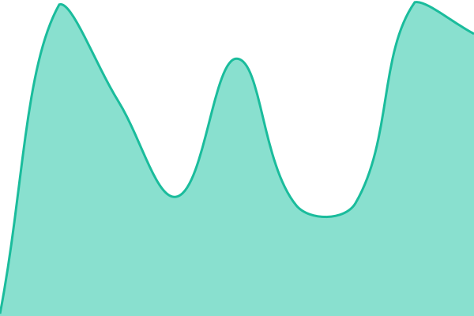
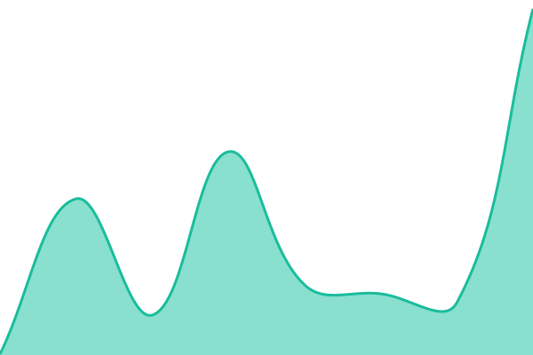
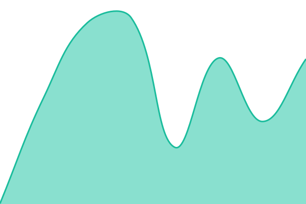

# [📈 Live Status](https://acm-uic.github.io/upptime): <!--live status--> **🟧 Partial outage**

This repository contains the open-source uptime monitor and status page for [ACM@UIC](acm.cs.uic.edu), powered by [Upptime](https://github.com/upptime/upptime).

With [Upptime](https://upptime.js.org), you can get your own unlimited and free uptime monitor and status page, powered entirely by a GitHub repository. We use [Issues](https://github.com/acm-uic/upptime/issues) as incident reports, [Actions](https://github.com/acm-uic/upptime/actions) as uptime monitors, and [Pages](https://acm-uic.github.io/upptime) for the status page.

Monitoring secrets are explicitly allowlisted by `secrets` in `.upptimerc.yml`. The list is empty because the monitored endpoints are public; the GitHub token is passed separately. If authenticated checks or secret-based notifications are added, list only their required secret names there and regenerate the workflows. Do not restore `toJson(secrets)`: it exposes every secret to the action and may cause GitHub to hold workflow runs for approval.

### GitHub App authentication

The generated Upptime workflows support a dedicated GitHub App. The default `GITHUB_TOKEN` cannot push changes to `.github/workflows`, so automatic template updates require the App token (or a separately configured `GH_PAT`).

1. Create a GitHub App with repository **Contents**, **Workflows**, **Issues**, and **Actions** permissions set to **Read and write**. Metadata read access is automatic. No organization permissions or webhook subscriptions are needed.
2. Install the App on **only `acm-uic/upptime`**.
3. Under repository **Settings > Secrets and variables > Actions**, create a repository variable named `GH_APP_ID` containing the App's **Client ID** (not its numeric App ID), and a repository secret named `GH_APP_PRIVATE_KEY` containing a generated PEM private key. Upload the key directly to GitHub; never commit it.
4. Merge the workflow changes, then dispatch a new **Setup CI** run on `main`. Re-running the earlier failed run would use its old workflow, which does not create an App token.

The workflows create a short-lived installation token before checkout and use it for GitHub operations. They clear the private-key environment variable before running Upptime, and the token action revokes its token when the job ends. Leave `secrets: []` unchanged: App authentication is wired separately and does not require exposing the private key through `SECRETS_CONTEXT`. Future Upptime template updates retain this built-in authentication.

<!--start: status pages-->
<!-- This summary is generated by Upptime (https://github.com/upptime/upptime) -->
<!-- Do not edit this manually, your changes will be overwritten -->
<!-- prettier-ignore -->
| URL | Status | History | Response Time | Uptime |
| --- | ------ | ------- | ------------- | ------ |
|  [ACM@UIC Website acm-uic.github.io](https://acm-uic.github.io) | 🟩 Up | [acm-uic-website-acm-uic-github-io.yml](https://github.com/acm-uic/upptime/commits/HEAD/history/acm-uic-website-acm-uic-github-io.yml) | 

 144ms
     
 | 

<a href="https://acm-uic.github.io/upptime/history/acm-uic-website-acm-uic-github-io">100.00%</a>
    

|  [ACM@UIC Website acmuic.org](https://acmuic.org) | 🟥 Down | [acm-uic-website-acmuic-org.yml](https://github.com/acm-uic/upptime/commits/HEAD/history/acm-uic-website-acmuic-org.yml) | 

 213ms
     
 | 

<a href="https://acm-uic.github.io/upptime/history/acm-uic-website-acmuic-org">100.00%</a>
    

|  [ACM@UIC Website acm.cs.uic.edu](https://acm.cs.uic.edu) | 🟩 Up | [acm-uic-website-acm-cs-uic-edu.yml](https://github.com/acm-uic/upptime/commits/HEAD/history/acm-uic-website-acm-cs-uic-edu.yml) | 

 358ms
     
 | 

<a href="https://acm-uic.github.io/upptime/history/acm-uic-website-acm-cs-uic-edu">100.00%</a>
    

|  [Plausible Analytics](https://plausible.acmuic.org/api/health) | 🟥 Down | [plausible-analytics.yml](https://github.com/acm-uic/upptime/commits/HEAD/history/plausible-analytics.yml) | 

 143ms
     
 | 

<a href="https://acm-uic.github.io/upptime/history/plausible-analytics">100.00%</a>
    

|  [ACM@UIC Website Typesense](https://typesense.acmuic.org/health) | 🟩 Up | [acm-uic-website-typesense.yml](https://github.com/acm-uic/upptime/commits/HEAD/history/acm-uic-website-typesense.yml) | 

 294ms
     
 | 

<a href="https://acm-uic.github.io/upptime/history/acm-uic-website-typesense">100.00%</a>
    

|  [Pathfinder](https://umpf.acmuic.org) | 🟩 Up | [pathfinder.yml](https://github.com/acm-uic/upptime/commits/HEAD/history/pathfinder.yml) | 

 269ms
     
 | 

<a href="https://acm-uic.github.io/upptime/history/pathfinder">100.00%</a>
    

|  [LUG@UIC website lug.cs.uic.edu](https://lug.cs.uic.edu) | 🟩 Up | [lug-uic-website-lug-cs-uic-edu.yml](https://github.com/acm-uic/upptime/commits/HEAD/history/lug-uic-website-lug-cs-uic-edu.yml) | 

 463ms
     
 | 

<a href="https://acm-uic.github.io/upptime/history/lug-uic-website-lug-cs-uic-edu">100.00%</a>
    

<!--end: status pages-->

[**Visit our status website →**](https://acm-uic.github.io/upptime)

## 📄 License

- Powered by: [Upptime](https://github.com/upptime/upptime)
- Code: [MIT](./LICENSE) © [Anand Chowdhary](https://anandchowdhary.com), supported by [Pabio](https://pabio.com)
- Data in the `./history` directory: [Open Database License](https://opendatacommons.org/licenses/odbl/1-0/)
